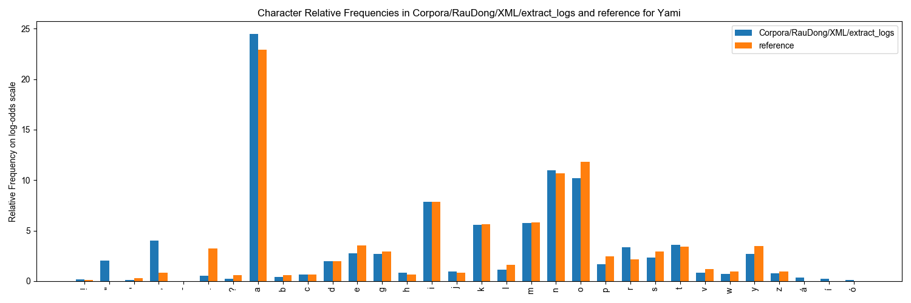

# RauDong — Yami texts (Rau & Dong 2006)

[The Rau-Dong Corpus](XML/) contains 20 morphologically parsed and glossed
texts in Yami from Rau and Dong (2006).

## Languages and dialects

Yami (Tao), ISO 639-3 `tao`. All 20 files carry `xml:lang="tao"`. Every text
carries `dialect="Yami"`.

Each file's `TEXT/@source` names the storyteller and village as the source
prints them: Yayo (椰油村) for texts 1–6, 14 and 16, Iranmilek (東清村) for the
other twelve. The corpus does not treat these villages as separate dialects.

## Source

The 20 glossed Yami (Tao, `tao`) narrative texts published in

> Rau, D. V., & Dong, M. N. (2006). *Yami texts with reference grammar and
> dictionary.* Institute of Linguistics, Academia Sinica.

794 sentences, 13,295 words and 16,731 morphemes, each with Chinese and
English translations at the sentence, word **and** morpheme tier (except a few
glosses and one sentence translation the source leaves unknown; see Notes and
caveats). One file per text, named for the text. There is no audio.

This corpus was originally published as a book. The version included in
FormosanBank was scraped from a website prepared by the original authors. We
have not checked whether there are differences between that source and the
original book.

## Statistics

The table of word counts, audio, translations and glossing is generated from
`statistics/RauDong_corpora_stats.csv` and appears on this corpus's page
on the [FormosanBank site](https://formosanbank.github.io/FormosanBank/).

## How to cite

If you use this corpus, or anything derived from it, in a publication, cite both
FormosanBank and:

Rau, D. V., & Dong, M. N. (2006). *Yami texts with reference grammar and
dictionary.* Institute of Linguistics, Academia Sinica.

## License

**License:** CC BY-NC 4.0
**Rights source:** the copyright holder (see References), date not recorded in this repository; evidence: ask maintainer

The copyright holder made this corpus available CC BY-NC. The licence was recorded as `CC NC-BY` until 2026-10-17; POL-042 normalises an unversioned grant to 4.0 (maintainer approval of the normalisation sweep, 2026-10-17).

This corpus is available under CC BY-NC 4.0, with permission of the publisher
and authors.

#### License and AI Use

This corpus is subject to its source license and the central FormosanBank
terms in [LICENSE.md](../../LICENSE.md) and
[AI-USE-ADDENDUM.md](../../AI-USE-ADDENDUM.md). Commercial AI Use is
prohibited without prior written permission.

## Notes and caveats

- **Infixes are written with hyphens, not angle brackets.** The word tier
  writes `k-om-an`, `s-in-avat`, `ni-t-om-agtag`; the morpheme tier splits
  them into the infix and the root with `:` at the infixation point. This
  differs from the FormosanBank convention (`k<om>an` at word level, `-` at
  the infixation point) and is the reason 60 words report a mismatch between
  their hyphen count and their morpheme count. Converting the notation is a
  linguistic task that has not been done.
- **9 words have a single `UNK` morpheme child** instead of an analysis, so
  their morpheme tier does not reconstruct the word: `ngomon-an`, `ngomon`,
  `mapa-sila-siláp-i`, `veza-no-dehdeh`, `vozovóza`,
  `nimakalkalima-so-nakem` (×2), `pángap`, `kong-koan`.
- **Unknown glosses are `<UNCLEAR/>`** (POL-021 and POL-061 as amended
  2026-10-17; the amendments are in PR #297). The source glosses
  six morphemes `?` in both Chinese and English and leaves the five words
  above them unglossed: text 5 `kominazazang` and `minipinizozongan`, text 9
  `naway`, text 12 `s:yak` (a morpheme of a glossed word), text 14 `viknaz`,
  text 18 `nipapo`. Those 22 glosses (12 morpheme, 10 word) are
  `<TRANSL xml:lang="..."><UNCLEAR/></TRANSL>`. Text 9 sentence 23 has no
  sentence translation: the source gives only `句意不詳` / `(Sentence meaning
  not clear`, and a wholly unknown sentence translation is not emitted. The
  source's doubt about a gloss it does give is kept as written (text 2,
  `sombing` glossed `糞(日語?)`). The changes are listed row by row in
  `CodeAndDocs/unclear_glosses.tsv`.
- **One sentence appears twice** in text 16, at sentence 22 and sentence 50
  (`i-ké-yngen na no oo na ni ina na a ka no ama na am,`). The two occurrences
  sit in unrelated passages and the source gives each its own Chinese and
  English translation, so this is repetition in the narrative, not a
  duplicated extraction. Both are kept.
- **Parentheses and slashes.** `validate_text.py` reports 204 V122 findings,
  one per `(`, `)` or `/` character: 196 in translations, which are part of
  the published translations, not conversion artifacts, and 8 in the
  sentence FORMs (both tiers) of text 11 sentence 12 and text 13 sentence 13,
  whose parentheses are in the delivered text. (205 before text 9 sentence
  23's English translation was omitted; see above.)
- Translations frequently have explanatory parantheticals. A few of these
  have been removed, but most remain.
- There are differences relative to the reference text in terms of the
  frequency of glottal stops.



#### Tiers

Each `S`, `W` and `M` carries an `original` and a `standard` FORM, and a PHON
for each.

- **`original`** is Rau & Dong's own spelling, unmodified.
- **`standard`** is the same text with the lexical accent removed (see below)
  and, at sentence level only, with the morpheme-segmentation hyphens taken
  out so the sentence reads as running text. Word- and morpheme-level standard
  FORMs keep their hyphens.
- **PHON `original`** is derived from the `Orthographies/Ortho94` Yami
  profile, **PHON `standard`** from `Orthographies/Ortho113`.

In short:

* The original text has morphemes marked with hyphens. These are retained in
  the "original" tier at all three levels. The "standard" tier removes them
  from the sentence only, so the sentence reads as running text (`maniring`);
  standard word and morpheme forms keep them (`ma-niring`).
* Lexical accent is marked in the original tier but removed in the standard
  tier.
* The pronunciation (PHON) tiers were regenerated with the current tools in
  October 2026: variant vowels are written `[o|u]`, morpheme hyphens and
  punctuation are not part of PHON, accented vowels map to their plain vowel,
  and the standard tier's `z` is `r` (a bug had made it `ɻ`, merging z and r).
* Glosses the book marks `?` are published as `<UNCLEAR/>`, as are the few
  word glosses left empty inside glossed sentences; one sentence whose
  translation the book marks as not clear (text 9, S23) carries no
  translation.

#### Orthography

Rau & Dong write Yami in the letters of the ROC-94 official orthography — `ng
p b t d k g ' v c j s z h m n r l w y i e a o`, with no `f`, `q` or `u` — plus
an acute accent on vowels (`á é í ó`). The accent marks **lexical stress**,
not a distinct vowel. It is part of the source's spelling, so the `original`
tier keeps it; FormosanBank's common orthography does not write stress, so the
`standard` tier does not have it.

Two consequences a data user should know:

- `add_phonology` folds the stress accent before mapping (it marks stress, not
  a different segment), so accented vowels come out as the plain vowel in
  **original** PHON: `ma-níring` → `maniriŋ`. Before that shared change
  (2026-09-05) they came out as `*` (1,098 PHON values); the rebuild recorded in
  `CodeAndDocs/provenance.json` replaced all of them.
- 29 PHON values per tier (58 in all, original and standard) still contain
  `*`. In 20 of each 29 the form quotes Chinese (`國小二三年級`, `mi開開玩笑`,
  `nim要理i`); those characters have no Yami phonological value. The other 9
  of each 29 are the `UNK` morphemes described below: Ortho94 and Ortho113
  have no Yami `u`, so `UNK` comes out as `*nk`.

#### Notation inside the FORM tiers

- **`-`** marks morpheme boundaries in the `original` tier at all three
  levels, and in the `standard` tier at word and morpheme level.
- **`:`** marks the point of infixation inside an infixed root at morpheme
  level. `k-om-an` 'eat (AF)' is two morphemes: `om` (AF) and `k:an` (eat).
- **`'`** is the glottal-stop **letter**, not an apostrophe or a quote mark
  (132 occurrences per tier, original and standard alike: 44 each at sentence,
  word and morpheme level). Quotations are written with `"`.
- **`UNK`** appears as a morpheme FORM and gloss in 9 places where the source
  gives no morpheme analysis for the word.
- A handful of sentences contain Chinese words code-switched into the Yami
  text; they are transcribed as printed.

## Reproduction and processing

### How to reproduce

One command rebuilds the whole corpus. From the corpus folder:

```bash
./CodeAndDocs/generate_xml.sh
```

or, from the FormosanBank root:

```bash
bash Corpora/RauDong/CodeAndDocs/generate_xml.sh
```

The FormosanBank commit the published `XML/` was last built against is recorded in
[`CodeAndDocs/provenance.json`](CodeAndDocs/provenance.json) (POL-052; provenance
only, a rebuild always runs the current tools).

It takes an optional path to the FormosanBank checkout whose QC scripts should
be used (default: the checkout this corpus lives in); `FORMOSANBANK_ROOT` and
`PYTHON` do the same as environment variables. The script is idempotent — it
always starts from the snapshot, and a second run reproduces the first byte
for byte. It needs no network access and no files outside this corpus folder
and the FormosanBank checkout. There is no separate `validate.sh` for this
corpus.

Since October 2026 the published XML is rebuilt reproducibly:
`CodeAndDocs/generate_xml.sh` starts from a frozen snapshot of the XML as it
was published (`CodeAndDocs/pre_correction_snapshot/`) and re-runs the shared
cleaning, standardization and phonology tools;
`CodeAndDocs/provenance.json` records the FormosanBank commit of the published
build. The snapshot is not the original delivery: earlier in-place edits
(quotation marks, one split sentence in text 10, translation fixes) are part
of it.

#### Provenance and reproducibility

The machine-readable text of these 20 texts was supplied to FormosanBank
already digitized. **There is no scrape, OCR or parse stage in this repository
to re-run, and none can be reconstructed from what we hold.** The source of
record is therefore a snapshot of the XML in

    CodeAndDocs/pre_correction_snapshot/XML/

**The snapshot is not the XML as delivered.** It is the XML as published in
this repository at commit `2bed0e22f` (2026-10), after the original delivery
(commit `0d0df4710`, 2025-07-08) had been hand-corrected over several commits
between 2025-11 and 2026-06. Compared with the delivery, the snapshot has:

- a different sentence-level `original` FORM in 447 of the 793 delivered
  sentences — in 401 of them the only change is typographic double quotes
  (`“ ”`) becoming `"`;
- one sentence split in two: text 10, sentence 18 became sentences 18 and 18b
  (794 sentences in all);
- different sentence translations in 534 sentences (957 translation strings),
  mostly the same quote normalization plus `’` → `'`;
- structural changes, among them W and M ids, missing `kindOf` values,
  `TEXT` capitalization, `dialect="Yami"`, `zh`/`en` → `zho`/`eng`, and the
  files moved under `Yami/` and renamed;
- `standard` FORM and both PHON tiers, which the delivery did not have. The
  build regenerates all three (steps 2 and 3 below), so their snapshot values
  do not reach `XML/`.

No script in this repository replays those earlier edits; they exist only as
their result in the snapshot and in the git history. The delivered XML can be
recovered with `git show 0d0df4710:"Corpora/RauDong/XML/<file>"`.

The snapshot has had one edit since it was taken: its `TEXT/@copyright` was
changed from `CC NC-BY` to `CC BY-NC 4.0`, the same one-line change made to the
published XML on 2026-10-17 (POL-042).

Everything under `XML/` is rebuilt from that snapshot by
`CodeAndDocs/generate_xml.sh` (POL-047); nothing in `XML/` is hand-edited. If a
correction is ever needed, it is made by a script that runs as a pipeline step,
so it survives the next rebuild.

The `.png` files and `orthographic_info` in `CodeAndDocs/` are a character-
and word-frequency profile of the corpus produced during its original QC. They
document the corpus; they are not inputs to the build.

### What each step does

Before step 0, `generate_xml.sh` resolves the FormosanBank root (argument,
then `FORMOSANBANK_ROOT`, then two folders above the corpus) and the Python
interpreter (`PYTHON`, then `<bank>/.venv/bin/python`, then `python3`). It
compares the commit in `CodeAndDocs/provenance.json` with the checkout's
`HEAD` and, if they differ, prints a note on stderr and carries on; it never
stops for a mismatch. It stops if the snapshot folder is missing.

The steps it runs, in order:

```bash
# 0. restore XML/ from the snapshot
rm -rf XML && cp -r CodeAndDocs/pre_correction_snapshot/XML XML

# 1. canonicalize typography in the original tier
python <bank>/QC/cleaning/clean_xml.py --corpora_path XML

# 2. build the standard tier: copy of the original, minus the lexical acute
#    accent, minus sentence-level segmentation hyphens
python <bank>/QC/utilities/standardize.py --remove_accents --corpora_path XML

# 3. generate both PHON tiers
python <bank>/QC/utilities/add_phonology.py --orthography Ortho94 --corpora_path XML

# 4. unknown glosses -> <UNCLEAR/>, unknown sentence translation omitted
python CodeAndDocs/apply_unclear_glosses.py --corpora_path XML
```

**Step 0** deletes `XML/` and copies the snapshot in its place, so every run
starts from the same input.

**Step 1** (shared `clean_xml.py`) canonicalizes the original tier:
typographic quotes, dashes, tildes, null glyphs and XML entities. Step 1
currently changes nothing. It reports two typographic single quotes in
the Chinese translation of sentence 41 of text 1 and leaves them alone, which
is correct — they are Chinese quotation marks.

**Step 2** (shared `standardize.py --remove_accents`) rebuilds every standard
FORM as a copy of the original FORM, deletes accents from it (accented letters
the language's reference orthography attests would be kept; Yami's has none of
Rau & Dong's acute vowels), and, on sentences that have a morpheme tier (all of
them here), strips the segmentation hyphens (and any clitic `=`, of which this
corpus has none) from the sentence-level standard FORM only. No letter
conversion table is applied: Rau & Dong's letters are already the ROC-94
letters.

**Step 3** (shared `add_phonology.py --orthography Ortho94`) writes a PHON for
every FORM. Step 3's `--orthography Ortho94` supplies the **original** PHON;
the **standard** PHON comes from Ortho113, the scheme designated for Yami in the
repository's `standards.csv`.

Steps 1 and 2 write `cleaner_warnings.csv` / `standardize_warnings.csv` into
`XML/` when they have anything to report. Those are per-run reports: read them
after a run, then delete them. They are never committed.

**Step 4** is this corpus's own script. It applies the rows of
`CodeAndDocs/unclear_glosses.tsv` (see "Unknown glosses" under Notes and
caveats) and fails without writing anything if a row no longer matches the
snapshot, or if any wholly unknown gloss is left that the table does not list.
It runs last because the shared `standardize.py` and `add_phonology.py` do not
handle `<UNCLEAR/>` inside a translation. In detail:

- The table has 24 rows, each naming a `TEXT/@id`, a level (`S`, `W` or `M`),
  an element id, a translation language, the exact text the snapshot holds
  for that translation, and an action: 22 rows (10 word, 12 morpheme) say
  `unclear`, which empties the `TRANSL` and puts `<UNCLEAR/>` inside it; 2 rows
  (text 9 sentence 23, `eng` and `zho`) say `omit`, which removes the
  sentence's `TRANSL`.
- After applying the table it looks for any word or morpheme gloss that is
  still empty or exactly `?`, `??` or `???`, and any sentence translation that
  is exactly such a marker; finding one is an error.
- Only files with a table row are rewritten; it prints the counts of unclear
  word glosses, unclear morpheme glosses, omitted sentence translations and
  files changed.

There is no `apply_manual_edits.py` step because there are no recorded hand
edits (no `CodeAndDocs/manual_edits.xml`).
