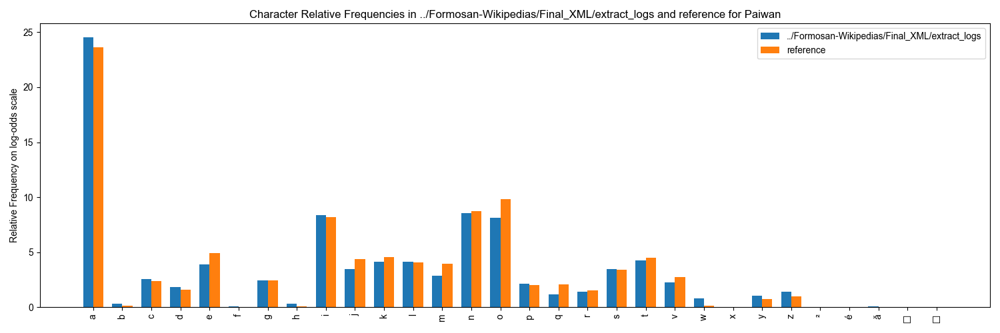
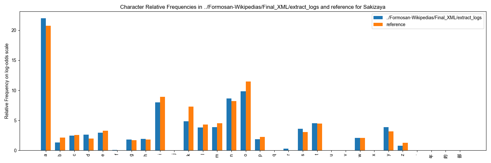

# Wikipedias

Wikipedia articles in the five Formosan languages that have a Wikipedia:
Amis (ami), Atayal (tay), Paiwan (pwn), Sakizaya (szy), and Seediq (trv),
scraped 2026-06 and structured into the FormosanBank XML format. One XML
file per article (12,748 articles), sentence tier only (no word
segmentation, no translations).

## Languages and dialects

Five languages, one folder each under `XML/`. Every file in a folder carries
the same `xml:lang` on its `<TEXT>` element:

| Folder | Language | `xml:lang` | `dialect` | Articles (files) |
|---|---|---|---|---|
| `XML/Amis/` | Amis | `ami` | `unknown` | 1,892 |
| `XML/Atayal/` | Atayal | `tay` | `unknown` | 2,935 |
| `XML/Paiwan/` | Paiwan | `pwn` | `unknown` | 455 |
| `XML/Sakizaya/` | Sakizaya | `szy` | `unknown` | 5,498 |
| `XML/Seediq/` | Seediq | `trv` | `unknown` | 1,968 |

The source does not record the dialect. Every article records
`dialect="unknown"`, because Wikipedia articles do not identify a dialect. The
Seediq articles (`xml:lang="trv"`) therefore count as Seediq, not Truku. They
are the Seediq Wikipedia (trv.wikipedia.org); there is no Truku Wikipedia.

## Source

#### Overview

The **Formosan Wikipedias Corpus** is a collection of articles sourced from
publicly available Formosan-language Wikipedias. **Amis**, **Atayal**,
**Sakizaya**, **Seediq**, and **Paiwan** have their own dedicated Wikipedia
editions, making them publicly accessible for research and education. These
articles provide a unique opportunity to document and analyze the linguistic
characteristics of these languages in a contemporary, digital context. Even
though the Wikipedias corpus doesn't have audio or translations associated with
it, it still is highly valuable for computational and linguistic applications.

After scraping the articles, they have been preprocessed to remove elements like
URLs, extraneous punctuation, and irrelevant text that is not relevant to the
linguistic structure of Formosan while preserving linguistic integrity. Similar
to the rest of the corpora in FormosanBank, the dataset is formatted in XML for
easy use in computational applications.

The articles were scraped in June 2026 (the XML citations record a retrieval
date of 2026-06-09). There is no audio.

* Below is a list of the wikipedias available in Formosan languages:
  * Amis: [https://ami.wikipedia.org](https://ami.wikipedia.org/)
  * Atayal: [https://tay.wikipedia.org](https://tay.wikipedia.org)
  * Sakizaya: [https://szy.wikipedia.org](https://szy.wikipedia.org)
  * Seediq: [https://trv.wikipedia.org](https://trv.wikipedia.org)
  * Paiwan: [https://pwn.wikipedia.org](https://pwn.wikipedia.org)
* The corpus XML and retained processing materials are available [in FormosanBank](https://github.com/FormosanBank/FormosanBank/tree/main/Corpora/Wikipedias).

#### The published corpus

The corpus has 12,748 articles, one XML file each: 1,892 Amis, 2,935 Atayal,
455 Paiwan, 5,498 Sakizaya and 1,968 Seediq. It is not re-scraped, because the
live wikis have changed since the June 2026 scrape. Instead,
`CodeAndDocs/generate_xml.sh` rebuilds `XML/` from that scrape, preserved in
`CodeAndDocs/pre_correction_snapshot/` (13,278 files), plus the recorded
corrections (corpus README, this file). On the way it:

* drops 29 articles the scrape saved twice under the same id (`<name> (1).xml`; the copies were identical) and 11 articles with no Latin letter at all;
* sets `dialect="unknown"` on every article, because no Wikipedia article identifies its dialect;
* restores Seediq text that the historical citation cutter removed: 25 articles get their cut-off body text back (28 source sections) and 5 get their author credit back, in the FORM `notes` attribute. Each is listed, with the source revision it was read from, in [`citation_restorations.csv`](CodeAndDocs/citation_restorations.csv);
* withdraws 490 articles that the scrape downloaded a second time under a title that redirects to them (108 Amis, 81 Atayal, 17 Paiwan, 194 Sakizaya, 90 Seediq; e.g. `Amis/Abraham_Lincoln.xml` was the article `Aparaham Linken`). No text is lost: each copy's text is published, character for character, under the article it redirects to. The withdrawn ids are listed in [`old_to_new_ids.csv`](CodeAndDocs/old_to_new_ids.csv) and [`source_redirects.csv`](CodeAndDocs/source_redirects.csv). Token counts fell by 1,311,509, because those copies had been counted twice; most of the Amis drop is one article, `Amis/Amilika.xml` ("America"), which 50 redirect titles led to;
* builds the standard tier as a copy of the original with accents removed (no spelling conversion, since the dialect is unknown), and PHON from the Ortho113 tables (see below).

#### Applications

Although the data doesn't have associated audio or translations, it still can
be relevant to a number of practical applications:

* The corpus provides authentic text data for training models in **natural language processing (NLP)** tasks, such as language modeling and text classification.
* Useful for developing tools like spell checkers and predictive text.
* Could be used for building surprisal and perplexity models, which would facilitate Quality Assurance of further collected data
* A stepping stone for creating digital resources and applications, such as dictionaries, and grammar-check tools, tailored to these languages.

## Statistics

The table of word counts, audio, translations and glossing is generated from
`statistics/Wikipedias_corpora_stats.csv` and appears on this corpus's page
on the [FormosanBank site](https://formosanbank.github.io/FormosanBank/).

## How to cite

If you use this corpus, or anything derived from it, in a publication, cite both
FormosanBank and:

* Wikipedia contributors. (2026). Amis Wikipedia. Wikimedia Foundation. Retrieved 2026-06-09, from https://ami.wikipedia.org/
* Wikipedia contributors. (2026). Atayal Wikipedia. Wikimedia Foundation. Retrieved 2026-06-09, from https://tay.wikipedia.org/
* Wikipedia contributors. (2026). Paiwan Wikipedia. Wikimedia Foundation. Retrieved 2026-06-09, from https://pwn.wikipedia.org/
* Wikipedia contributors. (2026). Sakizaya Wikipedia. Wikimedia Foundation. Retrieved 2026-06-09, from https://szy.wikipedia.org/
* Wikipedia contributors. (2026). Seediq Wikipedia. Wikimedia Foundation. Retrieved 2026-06-09, from https://trv.wikipedia.org/

Cite FormosanBank and each Wikipedia language edition used. The current XML
records a per-language citation in this form (each file's `citation`
attribute, with a matching BibTeX entry in `BibTeX_citation`):

* Wikipedia contributors. (2026). *[Language] Wikipedia*. Wikimedia Foundation. Retrieved 2026-06-09, from the corresponding language-edition URL.

## License

**License:** CC BY-SA 4.0
**Rights source:** Wikipedia contributors (the source wikis' licence), date not recorded in this repository; evidence: ask maintainer

The articles are Wikipedia text, which Wikipedia publishes under CC BY-SA. The
`@copyright` value was recorded without a version (`CC BY-SA`) until
2026-10-16, when it was normalized to `CC BY-SA 4.0` under POL-042 (a value
that names no version is 4.0). The same one-attribute change was made in the
POL-035 snapshot (`CodeAndDocs/pre_correction_snapshot/`, 13,278 files),
because `generate_xml.sh` copies that snapshot into `XML/` and a rebuild must
reproduce the new value.

According to [Wikipedia:Copyrights](https://en.wikipedia.org/wiki/Wikipedia:Copyrights)
page, Wikipedias can be used under the Creative Commons license CC BY-SA.
FormosanBank publishes this corpus under **CC BY-SA 4.0** (the `copyright`
value of every `TEXT` element).

> Most of Wikipedia's text and many of its images are co-licensed under the [Creative Commons Attribution-ShareAlike 4.0 International License](https://en.wikipedia.org/wiki/Wikipedia:Text_of_the_Creative_Commons_Attribution-ShareAlike_4.0_International_License) (CC BY-SA) and the [GNU Free Documentation License](https://en.wikipedia.org/wiki/Wikipedia:Text_of_the_GNU_Free_Documentation_License) (GFDL) (unversioned, with no invariant sections, front-cover texts, or back-cover texts). Some text has been imported only under CC BY-SA and CC BY-SA-compatible license and cannot be reused under GFDL; such text will be identified on the page footer, in the page history, or on the discussion page of the article that utilizes the text.

#### License and AI Use

This corpus is subject to its source license and the central FormosanBank
terms in [LICENSE.md](../../LICENSE.md) and
[AI-USE-ADDENDUM.md](../../AI-USE-ADDENDUM.md). Commercial AI Use is
prohibited without prior written permission. Wikipedia text is CC BY-SA.

## Notes and caveats

- **`dialect="unknown"` everywhere**: Wikipedia articles carry no dialect
  identification. For Seediq this means the corpus counts as Seediq, not
  Truku, under FormosanBank counting rules (trv counts as Truku only with
  an explicit `dialect="Truku"`).
- **Non-Formosan text** (from the old processing notes): Given the multilingual nature of Wikipedia articles,
  users should note the presence of occasional non-Formosan text (e.g., English
  characters or Chinese text). While these have been minimized, they may still
  appear at low frequencies.
- **PHON is provisional**: with dialect unknown, IPA uses default columns;
  dialect-dependent sounds appear as `[x|y]` variant groups. The corpus
  is phonologized under a blanket Ortho113 assumption, which the source
  text does not state. Characters with no IPA value (mostly digits, plus
  loanword letters and CJK) appear as `*`. What that assumption is worth,
  and what it costs, is documented in full in "Appendix — the orthography
  behind PHON" at the end of this file.
  **Decision (maintainer ruling, 2026-08-12): Ortho113 is used
  corpus-wide, for the reasons given in that appendix.** The one material
  divergence — Atayal `e` (Ortho113 `e` vs Church `ə`, 35,336
  occurrences) — is known, quantified there, and accepted as
  unadjudicable: the articles state no orthography and carry no
  translations, so no evidence could settle which value their authors
  intended.
- **Wiki-markup residue**: some articles retain asterisks (list markup),
  literal `|` from table/citation lines, and similar artifacts of the
  source pages. This residue is deliberately **retained as-is**
  (maintainer ruling 2026-08-12): it is audit-flagged (c022 / V129 / the
  `|` share of V146) but never silently edited out of the FORMs.
- **Apostrophes are assumed glottal** in Amis, Atayal, Paiwan and Sakizaya,
  and converted to quotation marks in Seediq; see "Apostrophe (`'`) handling"
  under "What each step does".

#### Limitations

Please beware that due to the nature of the wikipedias corpus (being collected
from public online article and heavily containing non-Formosan text), there are
some limitations in the corpus that should be pointed out.

* The standard tier (`<FORM kindOf="standard">`) is a copy of the original with accents removed. It does not convert spelling, so any English or other non-Formosan words are left as they are.
* The historical citation cutter sometimes stopped at an early reference heading and removed the article text after it. The 30 Seediq cases identified so far are repaired (see "The published corpus" above), including Nakahara, Kobah, Pratan and Bubun (body text) and Smangus (author credit). `Tausa`, which this page used to list as an example, is not among the 30. Other articles cut the same way, if any, have not been looked for.

#### Withdrawn articles: redirect copies

The scrape listed every page title on each wiki, including redirect titles,
so 490 articles were downloaded twice: once under their own title and once
under a title that redirects to it (e.g. `Amis/Abraham_Lincoln.xml` is the
article `Aparaham Linken` reached through the redirect `Abraham Lincoln`).
The copies are deleted (maintainer ruling 2026-10-18: "Yes, delete (record
the ids as withdrawn)"): 108 Amis, 81 Atayal, 17 Paiwan, 194 Sakizaya and
90 Seediq.

- [`CodeAndDocs/source_redirects.csv`](CodeAndDocs/source_redirects.csv)
  lists each deleted file and id, the kept article, the source titles, the
  evidence (wiki revision or redirect-log URLs) and the SHA-256 of the
  cleaned original FORM. `drop_redirect_copies.py` checks every copy before
  deleting any: same TEXT ids as listed, one S each, and the copy's original
  FORM identical to the kept article's and to the recorded hash. Any
  mismatch stops the build with nothing deleted.
- [`CodeAndDocs/old_to_new_ids.csv`](CodeAndDocs/old_to_new_ids.csv)
  records the 490 withdrawn `TEXT/@id`s (`old_id`), the id of the kept
  article with the same text (`new_id`), `change` = `withdrawn: redirect
  copy`, and the reason. No withdrawn id is reused.
- Six of the recorded hashes were re-recorded on 2026-10-18 when the
  deletion was ported onto the current build: the kept articles
  `Amis/Ina.xml`, `Atayal/’tayal.xml` (three copies),
  `Sakizaya/Fo-lu-lun-se.xml` and `Sakizaya/Lo-ma.xml` contain `''`, which
  the 2026-10-14 apostrophe step now writes as `"`. The copies still match
  their kept articles exactly.

Text is not lost: every withdrawn article's original FORM is published,
character for character, under the kept id. Token counts do fall, because
the copies were counted twice before: 1,311,509 tokens in all (Amis
1,131,630; Sakizaya 82,013; Seediq 65,191; Atayal 25,635; Paiwan 7,040).
Most of the Amis drop is one article: 50 redirect titles (US presidents and
`United_states`, among others) all led to the 21,766-token `Amis/Amilika.xml`
("America"), so the corpus held 51 copies of it. The 490 copies belong to
362 kept articles.

#### One file per article

- **One file per article**: the 29 twice-downloaded articles now have a
  single file each (pipeline step 3), and the 490 copies downloaded under
  redirect titles are withdrawn (step 7b; see above). One kept file has a
  `(1)` in its name, `Sakizaya/Oro’raw (1).xml`, because the scrape never
  wrote a counter-less copy (`Atayal/msin (1).xml`, the other such file,
  is one of the 490 redirect copies); the file names carry no meaning,
  the `TEXT/@id` does. Sentence-level duplication *across*
  articles (wiki boilerplate) is still reported SOFT by the
  duplicate-sentence validator — this corpus declares no dedup step.

## Reproduction and processing

### How to reproduce

The corpus is **not re-scraped**: the live wikis have moved on since the
2026-06 scrape, so the published XML is the baseline. The pristine
pre-correction XML is snapshotted in `CodeAndDocs/pre_correction_snapshot/`
(POL-035), and `CodeAndDocs/generate_xml.sh` regenerates `XML/` from it:

```bash
cd Corpora/Wikipedias
PYTHON=/path/to/python ./CodeAndDocs/generate_xml.sh [path-to-FormosanBank-root]
```

The FormosanBank root defaults to `../..` from the corpus folder, and `PYTHON`
defaults to `python3`. The build needs no network access and overwrites
`XML/Amis/`, `XML/Atayal/`, `XML/Paiwan/`, `XML/Sakizaya/` and `XML/Seediq/`.
There is no `validate.sh` for this corpus.

The FormosanBank commit the published `XML/` was last built against is
recorded in [CodeAndDocs/provenance.json](CodeAndDocs/provenance.json)
(POL-052). The build reads it only to print a note when the checkout it runs
in is a different commit; it always builds with the tools in that checkout.

The pipeline is deterministic and idempotent: consecutive runs produce
byte-identical output.

### What each step does

#### Reproducing `XML/`: steps, in order

The comments inside `generate_xml.sh` number these steps from 0 (restore =
0, `apply_manual_edits` = 1, …, `add_phonology` = 8); the numbers below are
one higher.

1. **Restore** `XML/` from `CodeAndDocs/pre_correction_snapshot/`
   (13,278 files).
   A shell loop deletes each of the five language folders under `XML/` and
   copies the snapshot's folder of the same name in its place.
2. **`QC/cleaning/apply_manual_edits.py`** — re-applies the recorded hand
   edits in `CodeAndDocs/manual_edits.xml` (POL-030); it runs before
   `clean_xml`. One edit is recorded: `Sakizaya/miladlad_tu_udip.xml`
   `S id="0"`, whose original FORM began with a stray `? ` from the scrape
   (V142). It is not a grammaticality marker — the article body simply
   starts after it — so the `? ` is dropped (maintainer ruling
   2026-08-12); the standard tier and PHON regenerate from the corrected
   original in later steps. A second Sakizaya record fixes `Luxembourg`
   (see "Apostrophe handling"). The other 30 records are Seediq: 25 restore
   article text the historical scrape cut off and 5 restore author credits
   — see "Restored Seediq source text and author credits" below.
   32 records in all; every one changes its file on a fresh build (the
   build log line is `apply: 32 edit(s) across 32 file(s); 0 no-op(s)`).
   `CodeAndDocs/manual_edits.md` is the readable changelog.
   Flag: `--corpora_path XML/`.
3. **`delete_duplicate_articles.py`** — the scrape saved 29 articles
   twice (duplicate downloads named `<name> (1).xml` / `(2)`), giving 58
   files with colliding `TEXT/@id`. One file per id is kept — the
   canonically-named one, or the lowest counter when the group has no
   counter-less file — and the other copy is deleted (29 files). Every
   group is byte-identical across its copies, so no content is lost.
   If a group ever stopped being byte-identical, the script would still keep
   the file the rule picks and print a `CONTENT DIFFERS` block with the
   FORM-level differences; a group with two counter-less files stops the
   build.
4. **`delete_nonlatin_articles.py`** — deletes the 11 articles whose
   FORMs contain no Latin letter at all (punctuation only, leftover
   `== ... ==` heading markup, or Chinese editorial remarks/headings).
   They are not language data.
   The test is mechanical: a character counts as a Latin letter when it is a
   letter whose Unicode name contains `LATIN`; digits alone do not keep an
   article.
5. **`add_dialect_attrs.py`** — sets `dialect="unknown"` on every TEXT.
   No Wikipedia article identifies its own dialect; the wikis are
   community-written with mixed dialect backgrounds.
   The attribute is inserted into the TEXT open tag right after `xml:lang`;
   nothing else in the file is rewritten, and a TEXT that already has a
   `dialect` is left alone.
6. **`normalize_seediq_quotes.py`** — Seediq only, before `clean_xml`;
   see "Apostrophe handling" below.
   It edits only `FORM kindOf="original"` in `XML/Seediq/`.
   Then **`normalize_double_apostrophes.py`** (the build's second apostrophe
   step, also before `clean_xml`) rewrites every run of exactly two
   apostrophes to `"` in the original FORMs of `XML/Amis/`, `XML/Atayal/`,
   `XML/Paiwan/` and `XML/Sakizaya/`; see "Apostrophe handling" below.
7. **`QC/cleaning/clean_xml.py`** — punctuation/Unicode canonicalization
   (NFC, HTML entities, typographic quotes/dashes, non-breaking spaces).
   Writes a per-run `XML/cleaner_warnings.csv`: review, then delete —
   it is never committed (POL-033).
   It is run with `--corpora_path XML/` only. A `quote_corrections.csv` row
   from this step would be unexpected, since this corpus has no TRANSLs.
7b. **`drop_redirect_copies.py`** — deletes 490 articles that the scrape
   downloaded a second time under a redirect title; see "Withdrawn
   articles: redirect copies" above, under "Notes and caveats". It runs after `clean_xml` because the
   hashes it checks are of the cleaned original FORM.
   It reads `CodeAndDocs/source_redirects.csv` and checks all 490 rows before
   deleting any file.
8. **`QC/utilities/standardize.py --remove_accents`** — standard tier =
   copy of the original tier with accents/stray combining marks removed.
   No conversion table is applied (dialect unknown).
   Accented letters that the language's standard orthography (Ortho113, per
   `standards.csv`) lists as letters are kept; null-unit markers (`∅`) are
   removed from the sentence-level standard FORM.
9. **`QC/utilities/add_phonology.py --orthography Ortho113`** — PHON
   tiers from the default (dialect-unknown) IPA columns. Sounds that
   differ by dialect appear as `[x|y]` variant groups; punctuation is
   not carried into PHON.
   It writes a PHON for the original FORM (from `--orthography Ortho113`) and
   one for the standard FORM (from each language's standard orthography in
   `standards.csv`, which is Ortho113 for all five). A character with no IPA
   value becomes `*`.

The published corpus is the 12,748 files this leaves: 1,892 Amis,
2,935 Atayal, 455 Paiwan, 5,498 Sakizaya and 1,968 Seediq.

**POL-047 deviation:** besides the canonical steps (restore the source,
`apply_manual_edits`, `clean_xml`, `standardize`, `add_phonology`), the
build runs corpus-local steps 3–6 before `clean_xml` (duplicate-download
and non-content deletion, `dialect="unknown"`, the two apostrophe rulings)
and step 7b after it (redirect-copy deletion, which must compare cleaned
text). Each implements a maintainer ruling on this corpus (2026-08-11/12,
2026-10-14, 2026-10-18), not a general cleaning rule. The source is
restored by a shell loop in `generate_xml.sh` rather than a corpus-local
`generate_xml.py`, since the step is a plain copy.

#### Restored Seediq source text and author credits

The historical scrape's citation cutter (`clean_articles.py`) stopped
reading 30 Seediq articles too early. 30 records in
`CodeAndDocs/manual_edits.xml` put the missing source text back
(maintainer ruling 2026-10-18, PR #176: "The manual edits are approve,
assuming they still run. The notes are approved."). Each record keeps the
article's previously published text unchanged as the start of the original
FORM; nothing already published is altered.

- **25 articles get their cut-off body text back** (28 source sections;
  Gluban has 3 and Tkijig 2). These are village articles whose later
  sections (beginning `Hangan alang` "village name") followed an early
  reference heading. The Chinese section labels that the source prints
  beside each Seediq heading — 322 in all, e.g. `Hangan alang(部落名稱)` —
  are kept in the FORM `notes` attribute, one per line, not in the text.
  Ten URL strings in the source sections are left out (link text, not
  language); the words around them are kept. Example: `Seediq/Ibuh.xml`
  went from 324 to 1,379 characters of original FORM.
- **5 articles get their author credit back**, in the FORM `notes`
  attribute only; their text is unchanged: Batul, Cyocuy, Hbun_kramay,
  Libu, Smangus (e.g. Libu: `Matis alang Ripu nii we, hlidan na Aking
  Nawi(黃美玉).`).

[`CodeAndDocs/citation_restorations.csv`](CodeAndDocs/citation_restorations.csv)
lists all 30: the source revision each was read from (a permanent
`trv.wikipedia.org/w/index.php?oldid=…` URL), the length and SHA-256 of the
previously published text that must remain the start of the FORM, the
SHA-256 of the notes, the number of restored sections and section labels,
and the excluded URLs. The restored text goes through the same Seediq
apostrophe step and `clean_xml` as everything else. These are the 30 cases
PR #176 identified; other articles cut the same way, if any, have not been
looked for since.

#### Apostrophe (`'`) handling

Treatment differs by language (maintainer ruling, 2026-08-11):

**All languages except Seediq**: the apostrophe is the glottal-stop letter
in these orthographies, and **`'` is assumed glottal by fiat**. Wikipedia
articles carry no translations, so FormosanBank's quote/glottal classifier
cannot confirm most cases; ambiguous `'` are accepted as glottal and not
warned on. This should be revisited when a better language model can do
reliable automatic correction. (Wikipedia authors also mix straight/curly
punctuation inconsistently — e.g. Sakizaya articles write a word-final
glottal `'` followed by a curly `’` closing quote — so codepoint
distinctions in the source cannot be trusted as signal.)

**Two apostrophes (`''`), Amis / Atayal / Paiwan / Sakizaya** (maintainer
ruling, 2026-10-14): the articles were downloaded as Wikipedia's plain-text
extracts (`download.py` uses `wikipediaapi`'s default `ExtractFormat.WIKI`,
i.e. TextExtracts with `explaintext=1`), in which MediaWiki has already
rendered `''italic''` markup away. A `''` that survives is a character the
page shows — two apostrophes typed for a double quotation mark, as found for
Seediq below. `CodeAndDocs/normalize_double_apostrophes.py` (pipeline step 6,
run after `normalize_seediq_quotes.py` and before `clean_xml`) rewrites every
run of exactly two apostrophes in original
FORMs to `"` (380 runs in 97 articles). Runs of three or more are left alone,
since they can contain a glottal letter; the one such run that is a glottal
plus a closing quote, Sakizaya `Luxembourg` `''a puyuay nubuyu'''` →
`"a puyuay nubuyu'"`, is corrected by a `CodeAndDocs/manual_edits.xml`
record.

**Seediq only**: Seediq orthography does not use `'` as a letter (no `'`
row in `Orthographies/Ortho113/Seediq.tsv`), and inspection of the trv
wikitext showed the corpus's apostrophes are quotation usage: literal `''`
pairs the authors typed as double-quote substitutes (`<nowiki>`-protected
so MediaWiki would not read them as italics markup) and single-quoted
titles of laws and documents. `CodeAndDocs/normalize_seediq_quotes.py`
(pipeline step 6, before `clean_xml`) therefore applies, to original FORMs
in `XML/Seediq/` only:

1. literal `''` → `"`;
2. every remaining `'` → `"`, with two exceptions that keep `'`:
   - **word-internal apostrophes** (a letter on both sides, e.g. `b'anux`,
     `hla'alua`, `mu'izzaddin`) — elided-vowel spellings and romanized
     names, not quotation marks;
   - the words `knita'` and `brbiru'`, which keep a genuine glottal `'`.
     These two occur in the article-stub boilerplate `cinkhulan sa knita'
     sa brbiru'` (≈ "source: seen in the writings/documents") and are
     Atayal vocabulary (`knita'` "view/seen", `biru'` "book/writing" —
     both attested only in Atayal corpora; Seediq uses *patas*), spelled
     with the Atayal glottal apostrophe.

#### Refreshing the source: `refresh_source.sh`

`CodeAndDocs/refresh_source.sh` (POL-047's optional source-acquisition
script) re-downloads the article text from the five live wikis with the
original scraper, `download.py`, into `CodeAndDocs/Articles/<Language>/`
(one plain-text file per article). By default it fetches every title in the
committed `Titles/` lists (the June 2026 inventory); `--new-titles` first
deletes those lists so `download.py` re-lists every article on each wiki.
It refuses to run when `Articles/` already exists, because `download.py`
skips files that are already there and would mix two download dates.
Requires network access to `*.wikipedia.org` and
`pip install -r CodeAndDocs/requirements.txt`.

`generate_xml.sh` never calls it, and a refresh changes no published data
by itself: the build reads only the committed snapshot. Turning a fresh
download into published XML is a re-scrape (the historical steps below,
reviewed, and a new snapshot committed), which needs the maintainer's
decision first.

#### Historical scrape provenance (not part of the pipeline)

The original scrape-and-clean scripts and their logs are kept in
`CodeAndDocs/` for provenance only: `download.py` (Wikipedia API scrape;
article lists in `Titles/`), `clean_articles.py` (TXT → XML; link/citation
removal), `remove_other_langs.py` (strips non-Formosan text),
`delete_empty_forms.py` (drops articles left empty),
`consolidate_citations.py` (one shared citation per language Wikipedia),
and the `*.log` files recording exactly what those steps removed. Their
input (the live wikis of 2026-06) no longer exists in that state, so they
are not re-run.
Two smaller helpers from the same period are also kept:
`MakeListOfMarkers.py` (adds a phrase to the cut-off list in
`citations_to_remove.pkl`) and `check_nonlatin.py` (writes `non_latin.log`, a
list of passages containing non-Latin characters).

##### Processing and Quality Control (the original 2026-06 scrape)

The steps in this section describe how the June 2026 scrape was made and
cleaned. They are kept for provenance and are not re-run.

The **Formosan Wikipedias Corpus** was created by sourcing articles from
publicly available Formosan-language Wikipedias, Amis, Atayal, Sakizaya,
Seediq, and Paiwan. Considering that the quality control pipeline of Wikipedias
isn't as rigorous as other resources in the Bank, extra effort went into
processing, cleaning, and QCing the Wikipedias articles. Below, we outline the
detailed processing steps and quality control measures applied to ensure the
corpus is both reliable and linguistically accurate.

##### Processing Steps

1. **Scraping Wikipedia Articles**
   * Articles were retrieved using the Wikipedia API for each language.
   * Titles of available articles were collected and stored in the `Titles` directory as pickle files for each language.
   * Using these titles, the articles were downloaded, saved as text files, and stored in the `Articles` directory.
   * Articles were initially saved in their raw, unprocessed format.
2. **Preprocessing and Cleaning**
   * Articles were cleaned to remove URLs, extraneous punctuation, and citation markers. Irrelevant content (e.g., non-Formosan text) was also removed.
   * The following logs were generated for quality assurance:
     * [**`link_removal.log`**](CodeAndDocs/link_removal.log): Lists URLs removed from the text.
     * [**`citations_remove.log`**](CodeAndDocs/citations_remove.log): Tracks removed citation sections.
     * [**`remove_possible_citations.log`**](CodeAndDocs/remove_possible_citations.log): Records sequence numbers and periods (common citation markers) that were removed.
     * [**`encoding_detection.log`**](CodeAndDocs/encoding_detection.log): Notes encoding issues and fixes for articles.
     * [**`citation_marker_removal.log`**](CodeAndDocs/citation_marker_removal.log): Tracks citation markers removed from within the text.
3. **Removing Non-Formosan Text**
   * Text in non-Formosan languages, such as English, Chinese, or other non-Latin scripts, was identified and removed.
   * Specific logs were generated for this step:
     * [**`remove_Annotations.log`**](CodeAndDocs/remove_Annotations.log): Tracks removal of non-Formosan commentary in parentheses.
     * [**`remove_large_blocks.log`**](CodeAndDocs/remove_large_blocks.log): Logs large non-Latin text blocks removed.
     * [**`remove_character_strings.log`**](CodeAndDocs/remove_character_strings.log): Notes removal of continuous segments of non-Latin text.
     * [**`remove_empty_parentheses.log`**](CodeAndDocs/remove_empty_parentheses.log): Tracks removal of empty parentheses.
4. **XML Structuring**
   * The cleaned articles were converted into the FormosanBank XML format, where each article was structured with a `<FORM>` element for the main text.
   * Metadata, including the article title and language code, was added to the XML files for organizational purposes.
   * These XML files were saved in the `XML` directory for further analysis and applications.
5. **Standardization and Punctuation Cleaning**
   * HTML escape codes were replaced with the corresponding characters, and a `kindOf="standard"` attribute was added to `<FORM>` elements. The original text would be `<FORM kindOf="original">`  and any text that will be standardized from this point will be in `<FORM kindOf="standard">`
   * XML files underwent additional cleaning to remove empty elements, standardize orthography, and merge Unicode diacritics with their base characters.

##### Quality Control

In addition to the thorough work done during processing to ensure the resulting
corpus is of high quality, further QC steps were conducted to validate and
enhance the dataset's reliability and usability. Some of these QC steps are
listed below:

1. **Cross-Linguistic Character Frequency Analysis**
   * A character frequency comparison was conducted between the Formosan Wikipedias and the [ILRDF corpus](../ILRDF_Dicts/README.md) (Indigenous Languages Research and Development Foundation). This ensures that expected Formosan characters dominate and non-Formosan characters (e.g., English characters used incidentally) appear at low frequencies.
   *   Below are the character-frequency graphs for the 5 languages compared to the ILRDF corpus:

Amis:


Atayal:


Paiwan:



Sakizaya:



Seediq:


2. **Annotation Verification**
   * Logs of removed annotations and non-Formosan text were reviewed to ensure edits were appropriate and did not inadvertently remove valuable linguistic data. Cases flagged for ambiguity were manually resolved.
3. **Consistency Checks on XML Structure**
   * The XML files were subjected to automated checks to ensure compliance with the FormosanBank schema. This included verifying the presence of required attributes (e.g., `kindOf="original"` and `kindOf="standard"`) and the absence of empty or malformed elements.
4. **Manual Spot Checks**
   * Random samples of the XML files were manually inspected to confirm proper segmentation, alignment, and the integrity of the linguistic content. These checks ensured the processed corpus accurately reflected the original articles' linguistic structures.

#### Appendix — the orthography behind PHON

**Short version.** The `PHON` tiers in this corpus are generated by mapping
each letter of the `FORM` text to IPA through **one** orthography table —
`Orthographies/Ortho113/`, dialect-agnostic column — for all five languages
and all articles. (The figures in this appendix were computed on the
13,238 articles published before the 490 redirect copies were withdrawn on
2026-10-18; they were not recomputed.) Wikipedia articles do not state which orthography
their author used, so this is an assumption, not a fact recovered from the
source. This appendix gives the evidence for it and the size of the residual
error, so you can decide whether `PHON` is usable for your purpose.

If you need phonemic precision, treat `PHON` here as a **broad, deliberately
under-specified** transcription and go back to `FORM`. If you need a rough
phone inventory, a searchable phonemic index, or a segment-level baseline,
`PHON` is sound to within the error described below.

##### What the evidence says

FormosanBank's orthography detector scores a text's letter inventory against
every reference orthography table available for its language. Run over this
corpus, combined per language (original tier):

| language | top-scoring table | score | where Ortho113 lands |
|---|---|---|---|
| Amis | Ortho94 (all five dialect columns tie) | 88.4% | below the top 7 |
| Atayal | Church (Sekolik) / Ortho94 (Sekolik), tied | 86.1% | 5th, 84.3% |
| Paiwan | **Ortho113** (four dialect columns tie) | 82.1% | 1st |
| Sakizaya | **Ortho113** | 73.2% | 1st (Ortho94 2nd, 65.0%) |
| Seediq | **Ortho113** | 87.9% | 1st (Ortho94 4th, 87.9%) |

So Ortho113 is the best-supported table for Paiwan, Sakizaya and Seediq. For
Amis and Atayal another table scores higher — and the reason is *not* that
those wikis spell differently; see "Where the tables disagree" below.

##### Is the orthography uniform across articles?

Effectively yes, as far as anything measurable shows. All 13,238 articles were
also scored individually:

| language | articles | best = Ortho113 | median score gap to the per-article winner |
|---|---|---|---|
| Amis | 2,000 | 225 (11.2%) | 0.018 |
| Atayal | 3,016 | 292 (9.7%) | 0.018 |
| Paiwan | 472 | 157 (33.3%) | 0.012 |
| Sakizaya | 5,692 | 5,209 (91.5%) | 0.000 |
| Seediq | 2,058 | 824 (40.0%) | 0.002 |

The per-article "winner" flips constantly, but the margins are within noise
(median gaps 0.000–0.018 on a 0–1 scale). The detector scores *inventory
coverage*, so a short article that happens not to use one letter of a larger
inventory hands the win to the smaller table. **These flips are scoring noise,
not evidence that different articles follow different spelling conventions.**
Nothing in the data supports phonologizing article by article, which is why a
single table is applied corpus-wide.

##### Where the tables disagree — and why it mostly costs ambiguity, not accuracy

For nearly every letter where Ortho113 and a rival table differ, Ortho113's
value is a **variant group** rather than a competing single value: it records
"this letter is `o` *or* `u`" where Ortho94 commits to one. Those disagreements
therefore surface in `PHON` as explicit `[x|y]` groups you can see and handle,
not as silently wrong segments:

| language | PHON tokens containing a `[x\|y]` group | commonest groups |
|---|---|---|
| Amis | 51.4% | `[o\|u]`, `[ɬ\|ɮ]`, `[b\|v]` |
| Atayal | 24.8% | `[s\|ɕ]`, `[ʦ\|ʨ]` |
| Sakizaya | 19.0% | `[r\|ɾ]`, `[ʔ\|ʡ]` |
| Paiwan | 0% | — |
| Seediq | 0% | — |

Genuinely *conflicting* single values — where Ortho113 commits to one IPA
value and a plausible rival table commits to a different one — are few and
enumerable:

| language | letter | Ortho113 | rival | occurrences |
|---|---|---|---|---|
| Atayal | `e` | `e` | Church `ə` | 35,336 |
| Seediq | `j` | `ɟ` | Church (Tegudaya) `ɖʐ` | 18,777 |
| Sakizaya | `f` | `f` | Ortho94 `b` | 6,507 |
| Paiwan | `o` | `u` | (not listed by Ortho94/Church) | 2,031 |

Together these are **under 0.4% of the corpus's letter occurrences**. The
largest single item is Atayal `e`: Church, the corpus-wide top-scoring table
for Atayal, reads it as `ə` where this corpus writes `e`, 35,336 times. If you
work on Atayal vowels, that is the one substitution to apply yourself.

##### Unmapped characters (`*`)

Any character with no IPA value in the table is written as `*` in `PHON`:

| language | `*` share of PHON characters | of the characters producing a `*`: digits |
|---|---|---|
| Amis | 1.39% | 89.3% |
| Atayal | 2.17% | 68.8% |
| Paiwan | 2.57% | 50.3% |
| Sakizaya | 2.28% | 60.4% |
| Seediq | 2.80% | 85.6% |

**None of this is attributable to Ortho113.** Between 50% and 89% of the stars
come from digits (dates, population figures, footnote numbers); most of the
rest are CJK quotations and loanword letters (`f`, `v`, `g`, `q`, `z`, `x`,
`J`, `R`) that no Formosan orthography table maps. Choosing Ortho94 or Church
instead would not change them — those tables have the same or smaller letter
inventories.

##### Summary for users of `PHON`

- One table (Ortho113, dialect-agnostic) for the whole corpus; the source does
  not state an orthography, and per-article detection shows no real variation.
- Best-supported table for Paiwan, Sakizaya and Seediq; for Amis and Atayal a
  rival scores higher because it is *less* cautious, not because the wiki
  spells differently.
- The dominant cost is **ambiguity**: 19–51% of Amis/Atayal/Sakizaya `PHON`
  tokens carry a `[x|y]` variant group (0% for Paiwan and Seediq).
- Outright disputable segments are bounded by four letters, under 0.4% of
  letter occurrences, the largest being Atayal `e` (35,336).
- 1.4–2.8% of `PHON` characters are `*` (no IPA value), mostly digits.

##### Decision

Ortho113 is used corpus-wide, for the reasons set out above. The one material
divergence — Atayal `e` (Ortho113 `e` vs Church `ə`, 35,336 occurrences) — is
known, quantified above, and accepted as **unadjudicable**: the articles state
no orthography and carry no translations, so there is no evidence that could
settle which value their authors intended. Users who need `ə` for Atayal should
apply that substitution themselves.
