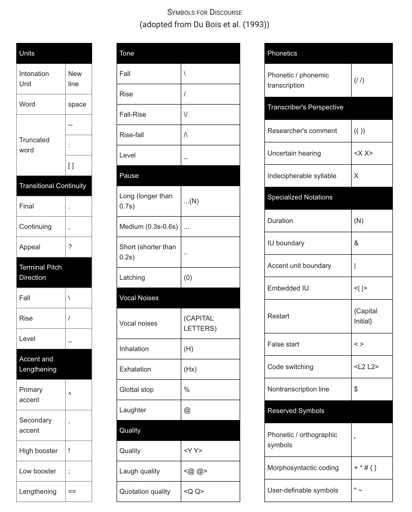

# NTU Corpus

## **Overview**

The NTU Corpus is a comprehensive and meticulously curated dataset representing 10 Indigenous Formosan languages: Kanakanavu, Rukai, Saisiyat, Tsou, Kavalan, Amis, Seediq, Atayal, Sakizaya, and Bunun. This corpus includes texts, audio recordings, elicited sentences, and example sentences from various sources such as grammar books and narrative collections. Designed to support linguistic research and revitalization efforts, the NTU Corpus provides a unique window into the diversity and complexity of Formosan languages. It's cruical to highligh that the NTU database adopts [the writing system](https://yongfu.name/temp-data/pdf/writingsystemsdoc.pdf) promulgated by the Council of Indigenous Peoples and the Ministry of Education on December 15, 2005.

***

## **Content Summary**

* **Languages Covered:**\
  Kanakanavu, Rukai, Saisiyat, Tsou, Kavalan, Amis, Seediq, Atayal, Sakizaya, and Bunun
*   **Corpus Size:**

    * **Texts with Audio Recordings (TWAs):** 234 texts across all languages
    * **Elicited Sentences:** 5,629 sentences
    * **Example Sentences from Grammar Books:** 6,636 sentences
    * **Word Class Books:** No entries currently available


* **Text Material Breakdown by Language:**
  * **Amis (Ciwkangan):** 18 TWAs
  * **Atayal (Mayrinax):** 11 TWAs
  * **Saisiyat (Tong-he):** 21 TWAs
  * **Tsou:** 12 TWAs
  * **Bunun (Isbukun):** 13 TWAs, 2,981 elicited sentences
  * **Kanakanavu:** 35 TWAs, 2,373 elicited sentences, 2,983 grammar examples
  * **Seediq (Tgdaya):** 41 TWAs, 2,122 grammar examples
  * **Kavalan (Xinshe):** 31 TWAs
  * **Rukai:** 22 TWAs, 2,275 elicited sentences
  * **Sakizaya:** 30 TWAs, 1,531 grammar examples

The **total audio time** for all languages is **17 hours, 47 minutes, and 36 seconds**. Below is the breakdown of audio time per language:

* **Amis (Ciwkangan):** 1 hour, 10 minutes, 17 seconds
* **Atayal (Mayrinax):** 1 hour, 7 minutes, 23 seconds
* **Saisiyat (Tong-he):** 2 hours, 1 minute, 4 seconds
* **Tsou:** 1 hour, 0 minutes, 14 seconds
* **Bunun (Isbukun):** 1 hour, 37 minutes, 43 seconds
* **Kanakanavu:** 2 hours, 24 minutes, 50 seconds
* **Seediq (Tgdaya):** 2 hours, 27 minutes, 41 seconds
* **Kavalan (Xinshe):** 2 hours, 57 minutes, 42 seconds
* **Rukai (Vedai):** 1 hour, 42 minutes, 35 seconds
* **Sakizaya:** 1 hour, 18 minutes, 7 seconds

The NTU Corpus also includes **free translations** of texts and sentences in **English** and **Chinese**

***

## **Morpheme-Level Glossing**

The NTU Corpus includes **morpheme-level glossing**, which provides detailed linguistic annotation for each morpheme in the corpus. Key features of the glossing process are:

* **Formosan Language Glossing:** Morphemes are glossed in the respective Formosan languages.
* **Chinese Glossing:** Each gloss is matched with its corresponding meaning in Chinese.

### **Why Glossing is Important:**

* **Supports Linguistic Research:** Morpheme-level glossing allows researchers to study detailed grammatical structures and unique features of Formosan languages.
* **Preserves Linguistic Knowledge:** This level of detail helps document endangered languages comprehensively.
* **Facilitates Educational Tools:** Glossing serves as a foundation for creating language-learning materials and dictionaries.

***

## **Glossing Conventions**

The glossing conventions for the NTU Corpus primarily follow the [**Leipzig Glossing Rules**](https://www.eva.mpg.de/lingua/resources/glossing-rules.php), with modifications to better capture the linguistic specificity of Formosan languages. Below are the alternative treatments for Leipzig Rules 6, 7, and 10, as well as other adopted coding conventions.

### **Modifications to Leipzig Glossing Rules**

1. **Rule 6 - Non-Overt Elements**
   * The symbol `[ ]` or `Ø` is not used for glossing non-overt elements.
   * Example:
     * **akoy** (Saisiyat) is glossed as `AF.many`.
     * In Tsou, the non-overt element in **bonu** ('to eat') is glossed as `eat.AF`.
2. **Rule 7 - Inherent Categories**
   * Coding for inherent categories is **not used**.
3. **Rule 10 - Reduplication**
   * Reduplication is not marked by the tilde `~`. Instead, the following conventions are adopted:
     * **Ca Reduplication:** Marked as `Ca-`.
       * Example: **ha-hila** (Saisiyat) is glossed as `Ca-sun`.
     * **Prefix-Type Reduplication:** Marked as `red-` if the reduplicated portion is at the beginning of the word.
       * Example: **m-li-lizaq** (Kavalan) is glossed as `af-red-happy`.
     * **Infix-Type Reduplication:** Marked as `<red>` if the reduplicated portion occurs in the medial position of the word.
       * Example: **sa-ru\<mi'a>mi'ad** (Amis) is glossed as `sa-<red>day`.

### **Glossing Focus Markers**

The following focus markers are **new abbreviations** introduced in the NTU Corpus to represent the specific focus morphology of Formosan languages:

* **AF:** Agent Focus
* **PF:** Patient Focus
* **RF (IF):** Referential Focus (Instrumental Focus)
* **LF:** Locative Focus

### **Focus Morphology in Tsou**

The Tsou language has a unique focus system compared to other Formosan languages:

* **Agent Focus (AF):** Glossed after the verb stem.
* **Patient Focus (PF):** Glossed similarly.
* Example:
  * **bonU/ana** ('to eat') → `eat.AF/eat.PF`.
  * **boacU/eoeca** ('to bite') → `bite.AF/bite.PF`.
  * Verbs with -m- or m- forms for AF:
    * **tmoecU/teoca** ('to hack') → `hack.AF/hack.PF`.
    * **matvo'ho/patvo'ha** ('to dare to say') → `dare.to.say.AF/dare.to.say.PF`.
    * **mooteo/totea** ('to wait') → `wait.AF/wait.PF`.

### **Replaced Abbreviations**

The NTU Corpus uses alternative abbreviations to standard Leipzig Glossing Rules to better fit Formosan languages:

| **Leipzig Abbreviation** | **NTU Corpus Abbreviation** |
| ------------------------ | --------------------------- |
| `caus`                   | `cau`                       |
| `dem`                    | `'this'` and `'that'`       |
| `nmlz`                   | `nmz`                       |
| `recp`                   | `rec`                       |

***

## Discourse coding

Discourse markings generally follow DuBois, with the following modifications:

1. Truncated intonation units are not marked.
2. To avoid confusion with the Leipzig Glossing Rules, truncated words are marked -- instead of -.
3. To avoid possible confusion with the Leipzig Glossing Rules, lengthening is marked == instead of =.
4. The symbol ‘^,’ originally used for primary accent, is now reserved to indicate a change of intensity, which is perceived as a focused (or "emphasized") prominent syllable which sometimes does not coincide with the stressed pattern of a word.

<figure><figcaption><p>Symbols for Discourse in NTU Corpus</p></figcaption></figure>

***

## Modified Spellings

In order to comply with the official Romanization system promulgated by the Council of Indigenous Peoples, and in order to unify the marking system for the languages in our corpus, the “one consonant marking” was adopted for the Kavalan vocabulary in the NTU corpus. It was, however, indicated by Prof. Paul Li of the Graduate Institute of Linguistics at the Academia Sinica that using the “double consonant marking” for certain words would render the spelling closer to the actual pronunciation. The words that were suggested to adopt the “double consonant marking” are the following:

1. ussiq: ‘one’ 一
2. siqqay: ‘snake’ 蛇
3. manna: ‘why’ 為什麼
4. zinneq: ‘heavy’ 重
5. bassing: ‘sneeze’ 打噴嚏
6. maRRung: ‘long’ 長
7. suppaR: ‘know’ 知道；會

***

## Stories used in Corpus

1. **The Frog Story**\
   Adapted from the Mercer Mayer "[Frog Series](http://www.amazon.com/exec/obidos/tg/detail/-/0140546324/002-7561052-6720039?v=glance)," this dataset captures narratives elicited using the story of a boy searching for his lost frog. These narratives are used to study motion events and the preferred construction types of various languages, providing insights into the cognitive and grammatical frameworks of Formosan languages.
2. **The Pear Stories**\
   Inspired by the film created by Chafe and his team, this corpus includes narratives describing a series of events involving pear-picking, theft, and other moral and emotional contexts. These stories serve as tools to study cause-and-effect relationships, background event descriptions, and emotional states across languages.

***

## **Corpus Notes**

This section will be used to describe any notes regarding the corpus (e.g. explaining the presence of characters that aren't part of the standard orthography)

*   In our efforts to maintain the integrity of the corpus, we occasionally reconstructed the original text when only morphologically-segmented text was available. The aim is to provide a comprehensive linguistic resource that remains true to the original usage and syntactic structuring. For instance, consider these components in the NTU Corpus:

    * **Morphologically-Segmented Text:** "walk-ed quickly home"
    * **Reconstructed Original Text:** "walked quickly home"

    An example is provided below for a sentence from the NTU Corpus and how we reconstructed the original sentence while keeping the morphologically-segmented text:


    <figure><figcaption></figcaption></figure>


    > ```xml
    > <S id="S_10">
    >         <FORM>tiku nanabakis miyan ga yava' miyan yutas miyan ru' mama' miyan musa' qumbuwang su yapit la musa' qumbuwang su yapit la ru.</FORM>
    >         <TRANSL xml:lang="zh"> 這個…我們的老人們，我們的爸爸爺爺叔伯們，躲在樹叢中找飛鼠…一面躲著一面找飛鼠。</TRANSL>
    >         <TRANSL xml:lang="en"> Well, our elders- our father, grandfather, and uncles, hid in the bush to look for flying squirrels.</TRANSL>
    >         <AUDIO file="AtaNr-hunting2_Buyung_S10.mp3" url="https://formosanbank.linguistics.ntu.edu.tw/files/audio/AtaNr-hunting2_Buyung.mp3"/>
    >         <W id="S10W0">
    >             <FORM>tiku</FORM>
    >             <M id="S10W0M0">
    >                 <FORM>tiku</FORM>
    >                 <TRANSL>PART</TRANSL>
    >                 <TRANSL ver="zh_gloss">發語詞</TRANSL>
    >             </M>
    >         </W>
    >         <W id="S10W1">
    >             <FORM>na-nabakis=miyan</FORM>
    >             <M id="S10W1M0">
    >                 <FORM>na</FORM>
    >                 <TRANSL>RED</TRANSL>
    >                 <TRANSL ver="zh_gloss">重疊</TRANSL>
    >             </M>
    >             <M id="S10W1M1">
    >                 <FORM>nabakis=miyan</FORM>
    >                 <TRANSL>elders=1PL.GEN</TRANSL>
    >                 <TRANSL ver="zh_gloss">老人們=1PL.屬格</TRANSL>
    >             </M>
    >         </W>
    >         .......
    > ```

***

## **Applications**

The NTU Corpus supports a wide range of linguistic and computational applications, including:

* Language documentation and revitalization.
* Grammar development and comparative studies of focus systems.
* Developing automated tools for translation and speech recognition in Formosan languages.
* Understanding cognitive frameworks for motion events and causality across languages.

***

## **Access Details**

* The original NTU corpus is publicly available [here](https://corpus.linguistics.ntu.edu.tw/#/).
* The repo containing the NTU corpus in FormosanBank as well as the code to reconstruct the corpus can be found here.

***

## Acknowledgements

This project is made possible through the collaboration of native speakers, linguists, and researchers. Special thanks to the [**NTU Graduate Institute of Linguistics**](https://homepage.ntu.edu.tw/~gilntu/) and [**Professor Sung**](https://drive.google.com/file/d/1pkqbvFYHUydbiGRhPIgkBigkh2hpSCYi/view), project leader, for their invaluable contributions and to the broader Formosan communities for their support and engagement.

***

## **Copyrights**

To be added
