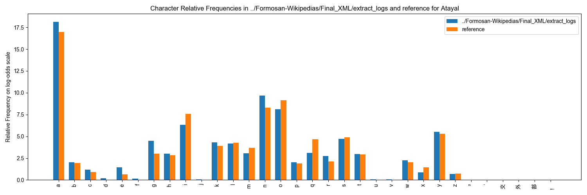
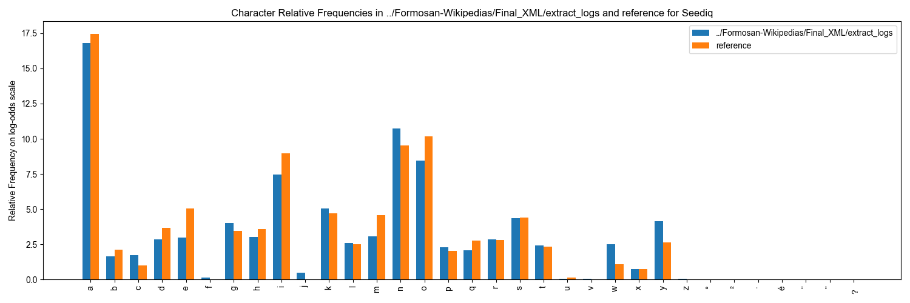

# Wikipedias

### **Overview**

The **Formosan Wikipedias Corpus** is a collection of articles sourced from publicly available Formosan-language Wikipedias.ِ **Amis**, **Atayal**, **Sakizaya**, **Seediq**, and **Paiwan** have their own dedicated Wikipedia editions, making them publicly accessible for research and education. These articles provide a unique opportunity to document and analyze the linguistic characteristics of these languages in a contemporary, digital context. Even though the Wikipedias corpus doesn't have audio or translations associated with it, it still is highly valuable for computational and linguistic applications.

After scraping the articles, they have been preprocessed to remove elements like URLs, extraneous punctuation, and irrelevant text that is not relevant to the linguistic structure of Formosan while preserving linguistic integrity. Similar to the rest of the corpora in FormosanBank, the dataset is formatted in XML for easy use in computational applications.

***

### Processing and Quality Control

The **Formosan Wikipedias Corpus** was created by sourcing articles from publicly available Formosan-language Wikipedias, Amis, Atayal, Sakizaya, Seediq, and Paiwan. Considering that the quality control pipeline of Wikipedias isn't as rigorous as other resources in the Bank, extra effort went into processing, cleaning, and QCing the Wikipedias articles. Below, we outline the detailed processing steps and quality control measures applied to ensure the corpus is both reliable and linguistically accurate.

***

### **Processing Steps**

1. **Scraping Wikipedia Articles**
   * Articles were retrieved using the Wikipedia API for each language.
   * Titles of available articles were collected and stored in the `Titles` directory as pickle files for each language.
   * Using these titles, the articles were downloaded, saved as text files, and stored in the `Articles` directory.
   * Articles were initially saved in their raw, unprocessed format.
2. **Preprocessing and Cleaning**
   * Articles were cleaned to remove URLs, extraneous punctuation, and citation markers. Irrelevant content (e.g., non-Formosan text) was also removed.
   * The following logs were generated for quality assurance:
     * [**`link_removal.log`**](https://github.com/FormosanBank/FormosanBank/blob/main/Corpora/Wikipedias/CodeAndDocs/link_removal.log): Lists URLs removed from the text.
     * [**`citations_remove.log`**](https://github.com/FormosanBank/FormosanBank/blob/main/Corpora/Wikipedias/CodeAndDocs/citations_remove.log): Tracks removed citation sections.
     * [**`remove_possible_citations.log`**](https://github.com/FormosanBank/FormosanBank/blob/main/Corpora/Wikipedias/CodeAndDocs/remove_possible_citations.log): Records sequence numbers and periods (common citation markers) that were removed.
     * [**`encoding_detection.log`**](https://github.com/FormosanBank/FormosanBank/blob/main/Corpora/Wikipedias/CodeAndDocs/encoding_detection.log): Notes encoding issues and fixes for articles.
     * [**`citation_marker_removal.log`**](https://github.com/FormosanBank/FormosanBank/blob/main/Corpora/Wikipedias/CodeAndDocs/citation_marker_removal.log): Tracks citation markers removed from within the text.
3. **Removing Non-Formosan Text**
   * Text in non-Formosan languages, such as English, Chinese, or other non-Latin scripts, was identified and removed.
   * Specific logs were generated for this step:
     * [**`remove_Annotations.log`**](https://github.com/FormosanBank/FormosanBank/blob/main/Corpora/Wikipedias/CodeAndDocs/remove_Annotations.log): Tracks removal of non-Formosan commentary in parentheses.
     * [**`remove_large_blocks.log`**](https://github.com/FormosanBank/FormosanBank/blob/main/Corpora/Wikipedias/CodeAndDocs/remove_large_blocks.log): Logs large non-Latin text blocks removed.
     * [**`remove_character_strings.log`**](https://github.com/FormosanBank/FormosanBank/blob/main/Corpora/Wikipedias/CodeAndDocs/remove_character_strings.log): Notes removal of continuous segments of non-Latin text.
     * [**`remove_empty_parentheses.log`**](https://github.com/FormosanBank/FormosanBank/blob/main/Corpora/Wikipedias/CodeAndDocs/remove_empty_parentheses.log): Tracks removal of empty parentheses.
4. **XML Structuring**
   * The cleaned articles were converted into the FormosanBank XML format, where each article was structured with a `<FORM>` element for the main text.
   * Metadata, including the article title and language code, was added to the XML files for organizational purposes.
   * These XML files were saved in the `XML` directory for further analysis and applications.
5. **Standardization and Punctuation Cleaning**
   * HTML escape codes were replaced with the corresponding characters, and a `kindOf="standard"` attribute was added to `<FORM>` elements. The original text would be `<FORM kindOf="original">`  and any text that will be standardized from this point will be in `<FORM kindOf="standard">`
   * XML files underwent additional cleaning to remove empty elements, standardize orthography, and merge Unicode diacritics with their base characters.

***

### **Quality Control**

In addition to the thorough work done during processing to ensure the resulting corpus is of high quality, further QC steps were conducted to validate and enhance the dataset's reliability and usability. Some of these QC steps are listed below:

1. **Cross-Linguistic Character Frequency Analysis**
   * A character frequency comparison was conducted between the Formosan Wikipedias and the [ILRDF corpus](ilrdf-dictionaries.md) (Indigenous Languages Research and Development Foundation). This ensures that expected Formosan characters dominate and non-Formosan characters (e.g., English characters used incidentally) appear at low frequencies.
   *   Below are the character-frequency graphs for the 5 languages compared to the ILRDF corpus:



<figure><figcaption></figcaption></figure>



<figure><figcaption></figcaption></figure>



<figure><figcaption></figcaption></figure>



<figure><figcaption></figcaption></figure>



<figure><figcaption></figcaption></figure>



2. **Annotation Verification**
   * Logs of removed annotations and non-Formosan text were reviewed to ensure edits were appropriate and did not inadvertently remove valuable linguistic data. Cases flagged for ambiguity were manually resolved.
3. **Consistency Checks on XML Structure**
   * The XML files were subjected to automated checks to ensure compliance with the FormosanBank schema. This included verifying the presence of required attributes (e.g., `kindOf="original"` and `kindOf="standard"`) and the absence of empty or malformed elements.
4. **Manual Spot Checks**
   * Random samples of the XML files were manually inspected to confirm proper segmentation, alignment, and the integrity of the linguistic content. These checks ensured the processed corpus accurately reflected the original articles' linguistic structures.

***

### **Processing Notes**

* Given the multilingual nature of Wikipedia articles, users should note the presence of occasional non-Formosan text (e.g., English characters or Chinese text). While these have been minimized, they may still appear at low frequencies.
* The current Wikipedia XML files do not record a `dialect` attribute. New and repaired files should use `dialect="unknown"` when the source variety cannot be identified, as required by the current validator.

***

### **Applications**

Although the data doesn't have associated audio or translations, it still can be relavant to a number of practical applications:

* The corpus provides authentic text data for training models in **natural language processing (NLP)** tasks, such as language modeling and text classification, .
* Useful for developing tools like spell checkers and predictive text.
* Could be used for building surprisal and preplexity models, which would facilitate Quality Assurance of further collected data
* A stepping stone for creating digital resources and applications, such as dictionaries, and grammar-check tools, tailored to these languages.

***

### **Limitations**

Please beware that due to the nature of the wikipedias corpus (being collected from public online article and heavily containing non-Formosan text), there are some limitations in the corpus that should be pointed out.

* in the `<FORM kindOf="standard">`, part of the standrdaization that is done to the data is replacing all u's with o's. This is because in Formosan languages, these two represent the same letter phonetically. However, since there is a low frequency occurrence of English words in the Wikipedias corpus that weren't excluded out in the processing and QC, these English words would also have u's switched to o's. For the time being it's hard to single out English words when applying that standardization. the letter u isn't that common in English, and there isn't that much English code-switching in the corpus after cleaning, so we don't expect this to be a major issue.
* In cleaning out citations, our code does have some false alarms, cutting out significant text. But that's fairly rare and not easily fixed. Below are some detected examples. Check the citation removal logs linked above if needed.
  * Articles/Seediq/Nakahara.txt
  * Articles/Seediq/Kobah.txt
  * Articles/Seediq/Smangus.txt
  * Articles/Seediq/Tausa.txt
  * Articles/Seediq/Pratan.txt
  * Articles/Seediq/Bubun.txt
  * And some others. Mostly Seediq.

***

### **Access Details**

* Blow is a list of the wikipedias available in Formosan languages:
  * Amis: [https://ami.wikipedia.org](https://ami.wikipedia.org/)
  * Atayal: [https://tay.wikipedia.org](https://tay.wikipedia.org)
  * Sakizaya: [https://szy.wikipedia.org](https://szy.wikipedia.org)
  * Seediq: [https://trv.wikipedia.org](https://trv.wikipedia.org)
  * Paiwan: [https://pwn.wikipedia.org](https://pwn.wikipedia.org)
* The corpus XML and retained processing materials are available [in FormosanBank](https://github.com/FormosanBank/FormosanBank/tree/main/Corpora/Wikipedias).

***

### **Copyright**

According to [Wikipedia:Copyrights](https://en.wikipedia.org/wiki/Wikipedia:Copyrights) page, Wikipedias can be used under Creative Commons liscene CC-BY SA:

> Most of Wikipedia's text and many of its images are co-licensed under the [Creative Commons Attribution-ShareAlike 4.0 International License](https://en.wikipedia.org/wiki/Wikipedia:Text_of_the_Creative_Commons_Attribution-ShareAlike_4.0_International_License) (CC BY-SA) and the [GNU Free Documentation License](https://en.wikipedia.org/wiki/Wikipedia:Text_of_the_GNU_Free_Documentation_License) (GFDL) (unversioned, with no invariant sections, front-cover texts, or back-cover texts). Some text has been imported only under CC BY-SA and CC BY-SA-compatible license and cannot be reused under GFDL; such text will be identified on the page footer, in the page history, or on the discussion page of the article that utilizes the text.

***

### Citation

In accordance with our [Terms of Use](../../additional-resources/tja-kipapawlingaven-a-cekaw-tua-ziriu-imaza.md), if you use this corpus or any product derived from it, cite FormosanBank and each Wikipedia language edition used. The current XML records a per-language citation in this form:

* Wikipedia contributors. (2026). *[Language] Wikipedia*. Wikimedia Foundation. Retrieved June 9, 2026, from the corresponding language-edition URL.
