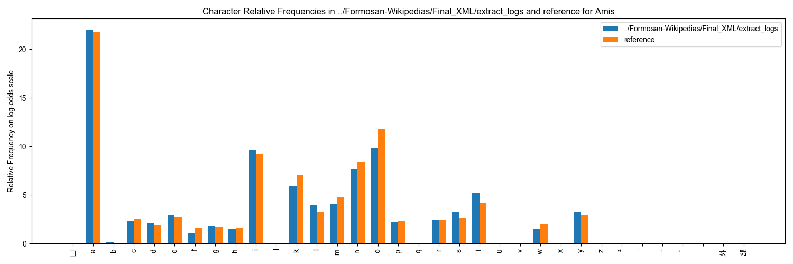
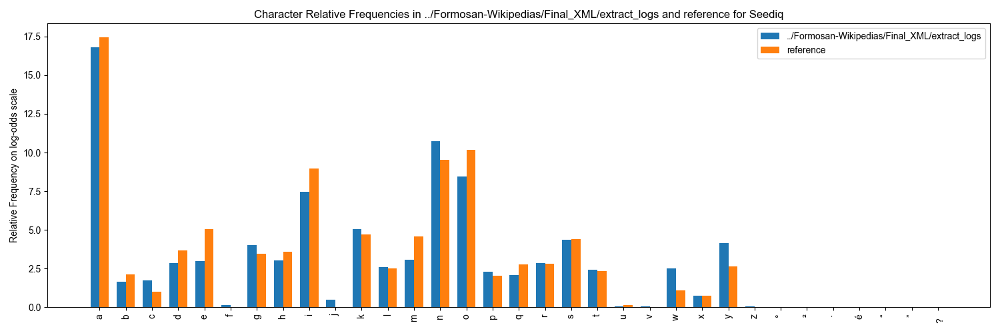

# 維基百科

### **概述**

臺灣南島語維基百科語料庫是一個公開可用的臺灣南島語維基百科文章典藏。目前，阿美語、泰雅語、撒奇萊雅語、賽德克語及排灣語各自擁有專屬的維基百科版本，並對外開放供研究與教育使用。儘管維基百科語料庫中不包含音檔或翻譯，然而其對於計算與語言學應用仍極具重要價值。

我們抓取百科文章並保留語言完整性之同時，一樣需要經歷多道清理與標準化程序例如移除URL、無關的標點符號或文本等，這與FormosanBank中的其他語料庫類似，該語料集以XML格式進行編排，利於日後在計算應用程式中使用。

**處理與品質管控**

臺灣南島語維基百科語料庫是從公開可用的臺灣南島語維基百科網站中抓取文章所創建的。基於維基百科的品質管控流程不如FormosanBank中的其他資源嚴格，我們特別加強對維基百科文章的處理、清理和品質管控。以下為詳細的處理步驟與品質管控措施，確保此語料庫的可靠性及準確性：

***

### **處理步驟**

1. 抓取維基百科文章
   * 使用維基百科API檢索各種語言的文章。
   * 將可用文章的標題收集並儲存於Titles目錄，作為各語言的打包(pickle)檔案。
   * 依據這些標題，下載文章後儲存成文字檔，保存在Articles目錄中。
   * 初始階段，文章以原始的、未經處理的格式保存。
2. 前置處理與清理
   * 清理文章以移除URL、無關的標點符號及引用標記，與語言結構無關的內容也一併刪除（例如：非臺灣南島語之文本）。
   * 為了保證品質，生成以下記錄檔：
     * [link\_removal.log](https://github.com/FormosanBank/FormosanBank/blob/main/Corpora/Wikipedias/CodeAndDocs/link_removal.log)：列出所有從文本中刪除的URL。
     * [citations\_remove.log](https://github.com/FormosanBank/FormosanBank/blob/main/Corpora/Wikipedias/CodeAndDocs/citations_remove.log)：追蹤移除的引用區塊。
     * [remove\_possible\_citations.log](https://github.com/FormosanBank/FormosanBank/blob/main/Corpora/Wikipedias/CodeAndDocs/remove_possible_citations.log)：記錄被刪除的序號和句點（常見引用標記）。
     * [encoding\_detection.log](https://github.com/FormosanBank/FormosanBank/blob/main/Corpora/Wikipedias/CodeAndDocs/encoding_detection.log)：記錄文章的編碼問題和修正。
     * [citation\_marker\_removal.log](https://github.com/FormosanBank/FormosanBank/blob/main/Corpora/Wikipedias/CodeAndDocs/citation_marker_removal.log)：追蹤從文本中刪除的引用標記。
3. 移除非臺灣南島語文本
   * 識別並移除非臺灣南島語的文本（例如：英語、華語或其他非拉丁文字）。
   * 為此移除步驟生成了特定的記錄檔：
     * [remove\_Annotations.log](https://github.com/FormosanBank/FormosanBank/blob/main/Corpora/Wikipedias/CodeAndDocs/remove_Annotations.log)：追蹤去除括號內非臺灣南島語的註解。
     * [remove\_large\_blocks.log](https://github.com/FormosanBank/FormosanBank/blob/main/Corpora/Wikipedias/CodeAndDocs/remove_large_blocks.log)：記錄移除的大型非拉丁文字區塊。
     * [remove\_character\_strings.log](https://github.com/FormosanBank/FormosanBank/blob/main/Corpora/Wikipedias/CodeAndDocs/remove_character_strings.log)：記錄去除連續的非拉丁文字段落。
     * [remove\_empty\_parentheses.log](https://github.com/FormosanBank/FormosanBank/blob/main/Corpora/Wikipedias/CodeAndDocs/remove_empty_parentheses.log)：追蹤去除空括號。
4. XML架構
   * 清理過的文章轉換為FormosanBank XML格式，每篇文章的主要內容皆以`<FORM>`元素來架構。
   * 後設資料如文章標題和語言代碼會加入到XML檔案中。
   * 這些XML檔案儲存於XML目錄中，以便進一步分析和應用。
5.  標準化與標點符號清理

    * 將HTML轉義碼替換為對應的字元，並且將kindOf="standard" 屬性新增到`<FORM>`元素中。原始文本標記為`<FORM kindOf="original">`，標準化的文本則標記為<`FORM kindOf="standard">`。
    * XML檔案經過進一步清理，移除空元素並標準化標點符號與拼寫，並將Unicode變音符號與其基本字元合併。

***

**品質管控**

除了處理過程中所做的工作以確保最終語料庫的高品質外，還進一步執行品質管控步驟，以驗證並提升語料集的可靠性和可用性。以下列出其步驟：

1. 跨語言字詞頻率分析
   * 進行臺灣南島語維基百科與[原語會族語辭典語料庫](https://docs.google.com/document/d/1eXZzq4oKyJD2CIsgI6vB6sZi9e0CoYoO/edit#heading=h.ihv636)（原住民族語言研究發展基金會）之間的字詞頻率比較。此步驟確保了預期的臺灣南島語字詞占大多數且非臺灣南島語字詞（例如偶爾使用的英文字母）出現頻率較低。
   * 以下是與原語會語料庫相比的五種語言的字詞頻率圖表：



<figure><figcaption></figcaption></figure>



<figure><figcaption></figcaption></figure>



<figure><figcaption></figcaption></figure>



<figure><figcaption></figcaption></figure>



<figure><figcaption></figcaption></figure>



2. 註釋複驗
   * 被刪除的註釋和非臺灣南島語文本的記錄會再複檢，以確保編輯適當，並且不會不小心刪除到有價值的語料。其他標記為模糊不清的案例則會手動消除。
3. XML 結構的一致性檢查
   * XML檔案經自動檢查，確保符合FormosanBank的架構模式，這包括檢驗所需屬性是否存在（例如：kindOf="original"和kindOf="standard"），以及是否含有空元素或異常元素。
4. 手動抽查
   * 隨機抽取的XML檔案樣本經由手動檢查，以確認語料的適當分段、對齊以及語言內容的完整性，確保處理過的語料庫準確地反映原始文章的語言結構。

***

### **處理附註**

* 鑑於維基百科文章的多語言特性，使用者應注意偶爾出現的非臺灣南島語文本（例如英語字母或華語文本）。儘管這些情況已被最小化，但仍可能出現。

***

### **應用**

儘管維基百科語料未附帶相關音訊或翻譯，仍與許多實際應用具有相關性：

* 該語料庫提供了真實的文本語料，可用於訓練自然語言處理（NLP）任務中的模型，如語言建模和文本分類。
* 可用於開發拼寫檢查器和預測文本等工具。
* 可用於建立驚訝度和困惑度模型，以促成未來所收集的語料的品質保證。
* 可作為專為這些語言打造的數位資源和應用程式的基礎（如字典和語法檢查工具）。

***

### **限制**

請注意，由於維基百科語料庫的性質（來自公開的線上文章且包含大量非臺灣南島語文本），該語料庫存在一些限制，特別在此指明。

* 在\<FORM kindOf="standard">中，對語料進行標準化處理的一部分是將所有的u替換為o。這是因為在臺灣南島語中，這兩者在語音上代表同一個字母。然而，由於維基百科語料庫中包含少量未能在處理和品質管控中排除的英語字詞，這些英語字詞也會將u替換為o。目前，在執行此一標準化過程時，我們難以單獨挑選出英語字詞，故暫時無法處理這個問題。不過英語字母u在英語中並不常見，且經過清理後，語料庫中的英語語碼代換也不多，因此我們認為這不會是一個重大問題。
* 在清理引用時，我們的程式碼確實存在一些誤報，導致刪除了重要的文字。但這種情況相當罕見，並且不容易修復。以下是一些檢測到的範例。如果需要，請檢視上面所提供的引用移除記錄連結。
  * Articles/Seediq/Nakahara.txt
  * Articles/Seediq/Kobah.txt
  * Articles/Seediq/Smangus.txt
  * Articles/Seediq/Tausa.txt
  * Articles/Seediq/Pratan.txt
  * Articles/Seediq/Bubun.txt
  * 還有一些其他的，主要是賽德克語

***

### **存取資訊**

* 您可以瀏覽以下臺灣南島語維基百科平台：
  * 阿美語：[https://ami.wikipedia.org](https://ami.wikipedia.org)
  * 泰雅語：[https://tay.wikipedia.org](https://tay.wikipedia.org)
  * 撒奇萊雅語：[https://szy.wikipedia.org](https://szy.wikipedia.org)
  * 賽德克語：[https://trv.wikipedia.org](https://trv.wikipedia.org)
  * 排灣語：[https://pwn.wikipedia.org](https://pwn.wikipedia.org)
* 您可在[此處](https://github.com/FormosanBank/FormosanBank/tree/main/Corpora/Wikipedias)找到FormosanBank中維基百科語料庫的儲存庫以及重建語料庫的程式碼。

***

### **版權**

根據[維基百科：版權](https://en.wikipedia.org/wiki/Wikipedia:Copyrights)頁面，維基百科可以在創用CC授權條款CC-BY-SA下使用：

> 維基百科的大部分文本和許多圖片都同時根據[創用CC署名-相同方式共享 4.0 國際授權版](https://en.wikipedia.org/wiki/Wikipedia:Text_of_the_Creative_Commons_Attribution-ShareAlike_4.0_International_License)（CC BY-SA）和[GNU自由文檔授權](https://en.wikipedia.org/wiki/Wikipedia:Text_of_the_GNU_Free_Documentation_License)（GFDL）（無版本、無不變部分、封面文本或封底文本）進行共有授權。有些文本僅依據CC BY-SA和與CC BY-SA相容的授權條款進行匯入，不能根據GFDL重用；這些文本將在頁面底部、頁面歷史或使用該文本的文章討論頁上標示出來。

***

### **引用說明**

依據我們的[使用條款](../../qi-ta-zi-yuan/shi-yong-tiao-kuan.md)，若您在任何出版物中使用此語料庫或任何由此語料庫衍生的產品，您必須同時引用FormosanBank和所使用的維基百科（對應具體語言）：

* 阿美語："Wikipedia: The free encyclopedia \[Amis version]. (2004, July 22). FL: Wikimedia Foundation, Inc. Retrieved Dec, 2024, from [https://ami.wikipedia.org](https://ami.wikipedia.org)"
* 泰雅語："Wikipedia: The free encyclopedia \[Atayal version]. (2004, July 22). FL: Wikimedia Foundation, Inc. Retrieved Dec, 2024, from [https://tay.wikipedia.org](https://tay.wikipedia.org)"
* 賽德克語："Wikipedia: The free encyclopedia \[Seediq version]. (2004, July 22). FL: Wikimedia Foundation, Inc. Retrieved Dec, 2024, from [https://trv.wikipedia.org](https://trv.wikipedia.org)"
* 排灣語："Wikipedia: The free encyclopedia \[Paiwan version]. (2004, July 22). FL: Wikimedia Foundation, Inc. Retrieved Dec, 2024, from [https://pwn.wikipedia.org](https://pwn.wikipedia.org)"
* 撒奇萊雅語："Wikipedia: The free encyclopedia \[Sakizaya version]. (2004, July 22). FL: Wikimedia Foundation, Inc. Retrieved Dec, 2024, from [https://szy.wikipedia.org](https://szy.wikipedia.org)"
